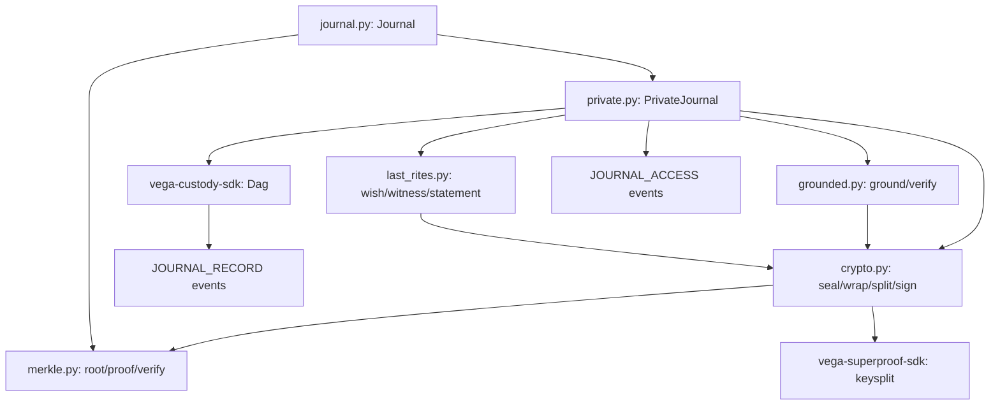

# vega-journal-sdk — Architecture

---

## 1. The organism (family picture)

The 16-layer Vega SDK stack (from ORGANISM_MAP.md), with **this repo's layer marked**:

```
                 ┌──────────────────────────┐
                 │   THE HUMAN (the owner)  │  holds the only signing key;
                 │  authority starts here   │  spends it one action at a time
                 └────────────┬─────────────┘
                              v single-use signed commitments
 15 assemble   vega-umbrella-sdk        the family as one organism: one keyed
                                        ledger, one approval check, one anchor,
                                        registry + pre-deploy audit
 14 deliberate vega-council-sdk         multi-brain deliberation, design-first builder
               vega-galaxy-sdk          the galaxy view of the knowledge lattice:
                                        levels, convergence, futures above the present
 13 watch      vega-governance-feed-sdk  live view of every chain + tamper alarms
 12 verify     vega-metacog-sdk          evidence rungs and the completion gate
 11 reason     vega-reasoning-sdk        fidelity, forecasting, routing: the lattice
                                        that predicts steps ahead
 10 observe    vega-trace-sdk            telemetry of reasoning: layer traces, entropy,
                                        harmonic echo, reference signature
  9 interface  vega-terminal-sdk         gated command execution for people and agents
  8 learn      vega-train-sdk            governed training + freeze cards: records
                                        exactly what a model learned from
  7 knowledge  vega-dkg-lattice-sdk      the knowledge graph: every fact with origin
                                        and licence; repo-library processing
  6 conduct    vega-harness-sdk          deterministic workflow conduct, pre-registered
                                        predicted paths, library use gate
  5 memory     vega-librarian-sdk        lessons and memory of past incidents
  4 contain    vega-two-gate-sdk         containment between two gates + the hard stop
  3 adapt      vega-pareah-sdk            adapters, cards, quarantine of inbound code:
                                        the dead-end room for the unannounced
  2 seal       vega-superproof-sdk       layered sealing and proof tiers
  1 authority  vega-governance-jacket-sdk human-only actions, single-use signed
                                        commitments, entry and exit gates
>>> 0 record     vega-custody-sdk          capsules, DAG, hash-chained ledger, safe paths,
                                        bounded processes — the foundation everything
                                        writes to <<<
```

**This repo (vega-journal-sdk) also sits at layer 0 (record)**, alongside vega-custody-sdk. It owns the **journal** concern: a verbatim, hash-chained Q&A record with a thought-genome map, encryption at rest, grants, legacy, and grounded answers.

**What layers below provide:** vega-custody-sdk provides the `Dag` (hash-chained ledger), `contains_credential` (credential redaction), and the `JOURNAL_RECORD`/`JOURNAL_ACCESS` event types. vega-superproof-sdk (layer 2) provides Shamir secret sharing (`keysplit`) for the legacy key.

**Who above consumes it:** Any higher-layer SDK that needs a tamper-evident, owner-controlled record of questions, answers, ideas, and wishes — e.g., vega-librarian-sdk (layer 5) for lesson distillation, vega-harness-sdk (layer 6) for predicted-path registration, vega-governance-feed-sdk (layer 13) for live chain viewing.

> **One family, one organism:** every SDK owns exactly one concern and uses the owner of every other concern instead of growing its own copy.

---

## 2. Internal drawing: modules and flow

```
┌─────────────────────────────────────────────────────────────────────────────┐
│                            VEGA-JOURNAL-SDK                                 │
├─────────────────────────────────────────────────────────────────────────────┤
│                                                                             │
│  ┌──────────────┐     ┌──────────────┐     ┌──────────────┐                │
│  │   journal    │     │   private    │     │  grounded    │                │
│  │   (base)     │────▶│  (encrypted, │────▶│  (answering) │                │
│  │              │     │  grants,     │     │              │                │
│  │  - entries   │     │  legacy,     │     │  - ground()  │                │
│  │  - ideas     │     │  last_rites) │     │  - verify()  │                │
│  │  - search    │     │              │     │              │                │
│  │  - receipts  │     │  - _authority│     │  - lexical_  │                │
│  │  - merkle    │     │  - ask()     │     │    relevance │                │
│  └──────┬───────┘     └──────┬───────┘     └──────┬───────┘                │
│         │                    │                    │                         │
│         │         ┌──────────┴──────────┐        │                         │
│         │         ▼                     ▼        │                         │
│         │  ┌─────────┐            ┌──────────┐   │                         │
│         │  │  crypto │            │ last_rites│   │                         │
│         │  │         │            │           │   │                         │
│         │  │ - seal  │            │ - wish()  │   │                         │
│         │  │ - wrap  │            │ - witness │   │                         │
│         │  │ - split │            │ - stmt    │   │                         │
│         │  │ - sign  │            │ - verify  │   │                         │
│         │  └────┬────┘            └──────────┘   │                         │
│         │       │                               │                         │
│         ▼       ▼                               ▼                         │
│  ┌─────────────────────────────────────────────────────┐                 │
│  │                    merkle.py                        │                 │
│  │  - root()  - proof()  - verify()  (RFC 6962)       │                 │
│  └─────────────────────────────────────────────────────┘                 │
│                                                                             │
└─────────────────────────────────────────────────────────────────────────────┘

DATA FLOW (▶):  entries → ideas → anchors → edges → receipts → merkle root
                 ▼
              private: encrypt → wrap keys → grants/legacy → ask → grounded
                 ▼
              last_rites: wish → witness → statement → verify

AUTHORITY FLOW (▼):  human (owner) signs commitment (wish, grant, legacy)
                        ▼
                     journal/private verifies signature
                        ▼
                     gate (_authority) allows/denies action
                        ▼
                     action executes, record written to chain
```

---

## 3. Mermaid version



---

## 4. Sequence: main scenario end-to-end

**Scenario: Owner asks a grounded question, gets answer, verifies it**

```
Owner                          PrivateJournal                    Grounded              Chain (Dag)
  │                                │                                │                      │
  │── initialise(signer) ─────────▶│                                │                      │
  │                                │── write "init" record ────────▶│                      │
  │                                │                                │                      │
  │── add/question/answer ────────▶│                                │                      │
  │                                │── encrypt entry, wrap keys ───▶│                      │
  │                                │── write entry record ─────────▶│                      │
  │                                │                                │                      │
  │                                │                                │                      │
  │── ask(party, question) ──────▶│                                │                      │
  │                                │── _authority(party) ──────────▶│                      │
  │                                │     (deny-by-default)          │                      │
  │                                │                                │                      │
  │                                │── unlock_for_search() ────────▶│                      │
  │                                │     (decrypt all to memory)    │                      │
  │                                │                                │                      │
  │                                │── candidates(pool) ───────────▶│                      │
  │                                │                                │── whole units,       │
  │                                │                                │     owner-only,      │
  │                                │                                │     in journal order │
  │                                │◀─── scored units ──────────────│                      │
  │                                │                                │                      │
  │                                │── ground(question, units) ────▶│                      │
  │                                │                                │── min_score,         │
  │                                │                                │     coverage_min,    │
  │                                │                                │     written order    │
  │                                │◀─── answer dict ───────────────│                      │
  │                                │                                │                      │
  │                                │── record JOURNAL_ACCESS ──────▶│                      │
  │                                │                                │                      │
  │◀─── grounded answer ───────────│                                │                      │
  │                                │                                │                      │
  │                                │                                │                      │
  │── verify_answer(q, ans) ──────▶│                                │                      │
  │                                │── fetch_entry(entry) ────────▶│                      │
  │                                │     (re-decrypt, check)        │                      │
  │                                │                                │                      │
  │◀─── True/False ────────────────│                                │                      │
```

**Scenario: Legacy policy release after death**

```
Owner                          PrivateJournal                    Executors               Chain
  │                                │                                │                      │
  │── set_legacy(executors,       │                                │                      │
  │     threshold, cooling,       │                                │                      │
  │     beneficiaries, signer) ──▶│                                │                      │
  │                                │── split legacy key L ────────▶│                      │
  │                                │     (Shamir k-of-n)            │                      │
  │                                │── seal service key S under L ──│                      │
  │                                │── seal beneficiary bundles ──▶│                      │
  │                                │     under L                    │                      │
  │                                │── write "legacy" record ──────▶│                      │
  │                                │                                │                      │
  │                                │                                │                      │
  │         [owner dies]           │                                │                      │
  │                                │                                │                      │
  │                                │◀─── prepare_death() ───────────│                      │
  │                                │     (declaration body)         │                      │
  │                                │                                │                      │
  │                                │◀─── sign declaration ──────────│  k executors sign    │
  │                                │                                │     same body        │
  │                                │                                │                      │
  │                                │── declare_death(body, sigs) ──▶│                      │
  │                                │     (verify k sigs, version)   │                      │
  │                                │── write "death" record ───────▶│                      │
  │                                │                                │                      │
  │                                │     [cooling-off period]       │                      │
  │                                │                                │                      │
  │                                │     [owner CAN cancel via      │                      │
  │                                │      alive(death_id, signer)]  │                      │
  │                                │                                │                      │
  │                                │     [cooling-off ends]         │                      │
  │                                │                                │                      │
  │                                │◀─── release(shares) ───────────│  present k shares    │
  │                                │                                │                      │
  │                                │── combine shares → L ─────────▶│                      │
  │                                │── open sealed service key S ──▶│                      │
  │                                │── rebuild search index         │                      │
  │                                │── write "released" record ────▶│                      │
  │                                │                                │                      │
  │                                │                                │                      │
  Beneficiary                    PrivateJournal                    │                      │
    │                                │                                │                      │
    │── beneficiary_open(name,     │                                │                      │
    │     box) ───────────────────▶│                                │                      │
    │                                │── open bundle under L ───────▶│                      │
    │                                │── unwrap grant key with box ─▶│                      │
    │                                │── decrypt entries ──────────▶│                      │
    │◀─── {entry: {text,seg}} ──────│                                │                      │
```

---

## 5. Trust boundaries

| Boundary | What crosses | Enforcement |
|----------|--------------|-------------|
| **Human → Journal** | Owner's signed commitments (init, grant, revoke, legacy, death, alive, wish, statement) | Ed25519 signature verification against owner's identity key; every policy record checked on load (`_apply_extra`). |
| **Model/Observer → Journal** | Entries (speaker=model/observer) | Stored verbatim but **never used for grounded answers**; origin tracked for ideas; conception receipt refuses to credit model's words to owner. |
| **Grantee → Journal** | Questions (ask), grant opens (grantee_open) | `_authority()` deny-by-default: requires active unrevoked unexpired grant + running service key (S) for answers_only; box private key for full. |
| **Beneficiary → Journal** | Questions (ask), bundle opens (beneficiary_open) | Requires `legacy_effective` status + `release()` completed + matching identity + box key (full) or scope (answers_only). |
| **Executor → Journal** | Death declaration signatures, release shares | `declare_death` verifies k-of-n signatures on identical body for current legacy version; `release` verifies shares open sealed service key. |
| **Journal → Chain (Dag)** | Every record → `JOURNAL_RECORD`; every ask → `JOURNAL_ACCESS` | Dag.write() called BEFORE file append; if Dag write fails, operation rolls back (`JournalRefused`). |
| **Journal → File** | Encrypted records (JSON lines) | Written after Dag success; `fsync()` on every write; load verifies every hash and `prev` link. |
| **Ciphertext → Position** | Encrypted entry keys and content | AAD = `entry|i|prev_hash`; moving ciphertext to another position fails decrypt (AAD mismatch). |
| **Third party → Receipt/Statement** | Conception receipt, statement of wishes | Verifiable from packet alone: `verify_receipt` checks Merkle path + quote hash; `verify_statement` checks export sig, notice, wish hashes, owner sigs, Merkle inclusion, witness sigs. |
| **Caller → Grounded engine** | Relevance function, min_score, coverage_min, max_units | `ground` validates params; `verify_answer` re-checks all rules independently; both refuse/return False on violation. |

---

## 6. Fail-closed workflow diagram (with module + function cites)

```mermaid
graph TD
    A[Operation requested] --> B{Validation gate}
    B -->|Invalid params| C[JournalRefused / GroundedRefused / CryptoRefused]
    B -->|Missing master key| D[Locked]
    B -->|Valid| E[_authority check]
    E -->|Deny| F[JournalRefused / Locked]
    E -->|Allow| G[Execute action]
    G --> H{Chain write<br/>(Dag.record)}
    H -->|Fail| I[JournalRefused<br/>no state change]
    H -->|Success| J[Append to file<br/>fsync]
    J --> K[Update in-memory state<br/>_apply / _apply_extra]
    K --> L[Return result]

    subgraph "Specific fail-closed points"
    M1[journal._load: chain break → JournalRefused]
    M2[journal._write: Dag fail → JournalRefused]
    M3[journal._entry: bad input → JournalRefused]
    M4[journal.answer: no question → JournalRefused]
    M5[journal.idea: redacted/dup/bounds → JournalRefused]
    M6[journal.derive: cycle/self → JournalRefused]
    M7[journal.conception_receipt: no origin → JournalRefused]
    M8[journal.verify_receipt: any mismatch → False]
    M9[private._entry_key: decrypt fail → None → Locked]
    M10[private._plain_of: no key → Locked; tamper → JournalRefused]
    M11[private._apply_extra: bad sig → rejected++]
    M12[private.grant: no M/bad keys → Locked/JournalRefused]
    M13[private.revoke: only owner+M → JournalRefused]
    M14[private.set_legacy: validation → JournalRefused]
    M15[private.declare_death: <k sigs/wrong ver → JournalRefused]
    M16[private.alive: only cooling-off+owner+M → JournalRefused]
    M17[private.release: not effective/bad shares → JournalRefused]
    M18[private._authority: deny-by-default → JournalRefused/Locked]
    M19[private.ask: Dag fail → JournalRefused]
    M20[grounded.ground: bad params → GroundedRefused; low cov → answerable:False]
    M21[grounded.verify_answer: any violation → False]
    M22[last_rites.wish: bad params/non-owner → JournalRefused]
    M23[last_rites.verify_statement: any mismatch → problems]
    end
```

**Key principle:** Every gate fails closed. No operation proceeds if any verification fails. State is only mutated after the chain write succeeds.

---

## 7. Custom constraint rule (verbatim)

> **User-defined constraints may be STRICTER than the legal minimum for the applicable jurisdiction, never looser. Jurisdictional legal minimums are defined by the jurisdiction registry (vega-jurisdiction-sdk); a custom constraint that would drop below a registered minimum is rejected at the gate.**

**Current status:** This version publishes no user-defined constraint hooks; constraints are fixed by the module and the jurisdiction floor.
